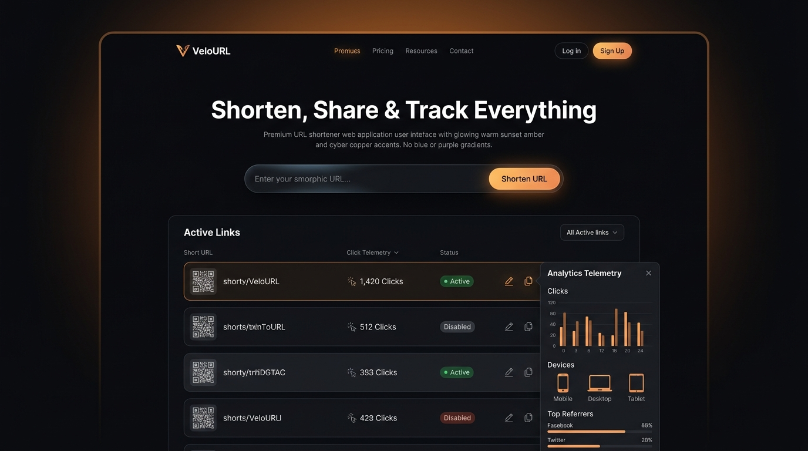

# ⚡ VeloURL - High-Performance URL Shortener & Analytics

> A modern, lightning-fast URL shortening platform engineered with a **Cyber Obsidian & Sunset Amber** aesthetic (designed deliberately without standard generic blue/purple AI palettes). Powered by **Node.js, Express, and native Node.js SQLite (`node:sqlite`)**.



---

## ✨ Features

- **⚡ Fast Redirection**: Low-latency 302 HTTP redirection handling thousands of requests effortlessly.
- **🏷️ Custom Slugs / Aliases**: Real-time availability validation when typing custom link identifiers (e.g. `/my-portfolio`).
- **⏳ Link Expiration (TTL)**: Optional automatic expiration intervals (1 hour, 24 hours, 7 days, 30 days, or permanent).
- **📊 Real-time Click Telemetry & Analytics**:
  - Total visits counter
  - Daily visits timeline
  - Device breakdown (Desktop, Mobile, Tablet)
  - Browser distribution (Chrome, Safari, Firefox, Edge, etc.)
  - Operating system breakdown (Windows, macOS, Linux, iOS, Android)
  - Referrer tracking (Direct, Twitter/X, GitHub, Reddit, etc.)
  - Real-time recent click stream with timestamps & client metadata
- **📱 Instant QR Codes**: High-resolution QR code generator with one-click PNG download.
- **⏯️ Pause / Resume Links**: Instant toggle to pause or reactivate any shortened link without deletion.
- **🔍 Filter & Search**: Search links by keyword, title, or destination, and filter by Active, Expired, or Paused states.
- **🗄️ Zero-Config Native SQLite**: Powered by Node 22's native `DatabaseSync` (`node:sqlite`) with zero C++ compilation dependencies.

---

## 🚀 Quick Start

### Prerequisites
- [Node.js](https://nodejs.org/) v22+ (for native `node:sqlite` support)
- Git 

### Installation
```bash
# Clone the repository
git clone <your-repo-url>
cd "URL Shortner"

# Install dependencies
npm install

# Start the server
npm start
```

Open [http://localhost:3000](http://localhost:3000) in your browser.

---

## 🛠️ Tech Stack

- **Backend**: Node.js v22, Express.js
- **Database**: Native Node.js SQLite (`node:sqlite` DatabaseSync)
- **Frontend**: Semantic HTML5, Vanilla CSS3 (Custom Obsidian Amber Design System), Vanilla JS (ES6+)
- **Metadata & QR**: `qrcode`, `ua-parser-js`

---

## 📁 Project Structure

```
├── data/              # SQLite database storage (urls.sqlite)
├── public/
│   ├── css/
│   │   └── style.css  # Bespoke Obsidian & Sunset Amber stylesheet
│   ├── js/
│   │   └── app.js     # Reactive frontend engine & analytics
│   └── index.html     # Semantic single-page dashboard
├── src/
│   ├── db.js          # SQLite schema, queries & analytics aggregations
│   └── server.js      # Express API routes, redirects & QR generation
├── .gitignore
├── package.json
└── README.md
```

---

## 📡 API Reference

| Endpoint | Method | Description |
|---|---|---|
| `POST /api/shorten` | POST | Create a new short link (`originalUrl`, `customCode`, `title`, `expiresInHours`) |
| `GET /api/links` | GET | List links with optional `search` and `filter` query parameters |
| `GET /api/stats/global` | GET | Get total links, total clicks, and active count |
| `GET /api/analytics/:code` | GET | Comprehensive analytics for a short link |
| `GET /api/qr/:code` | GET | Generate QR code data URL for link |
| `PATCH /api/links/:code/toggle` | PATCH | Pause or activate a link |
| `DELETE /api/links/:code` | DELETE | Delete link and its analytics |
| `/:code` | GET | HTTP 302 Redirection & click telemetry recorder |

---

## 📄 License
ISC License.
